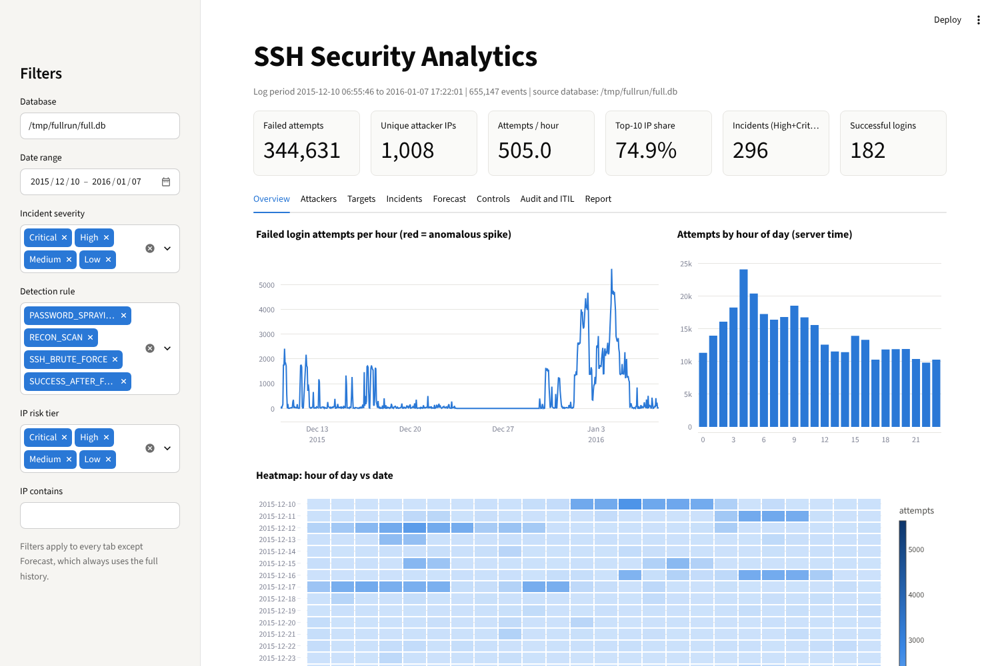
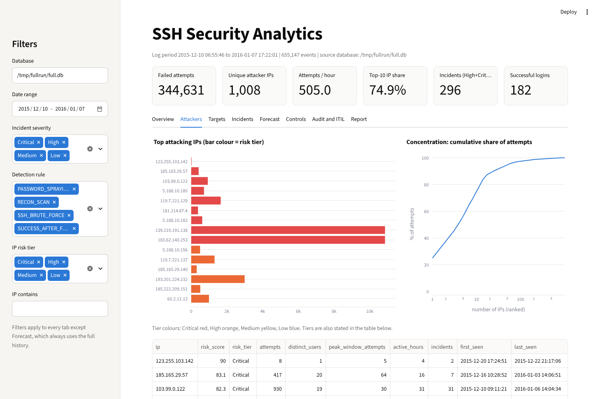
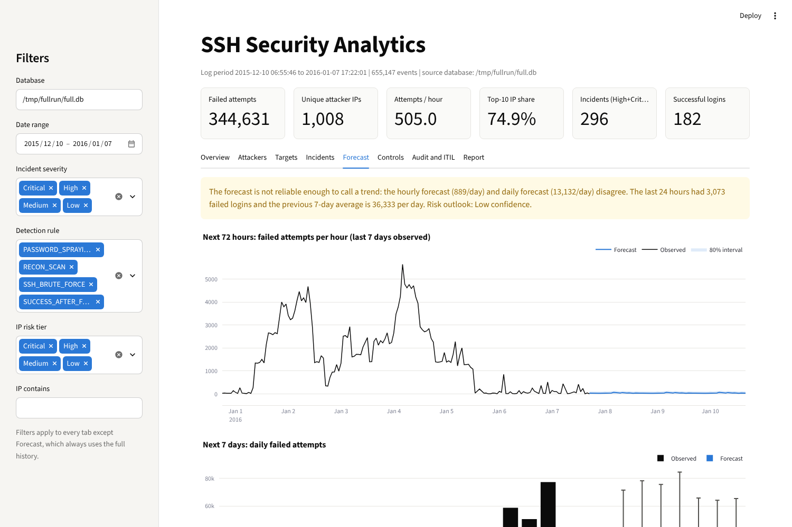
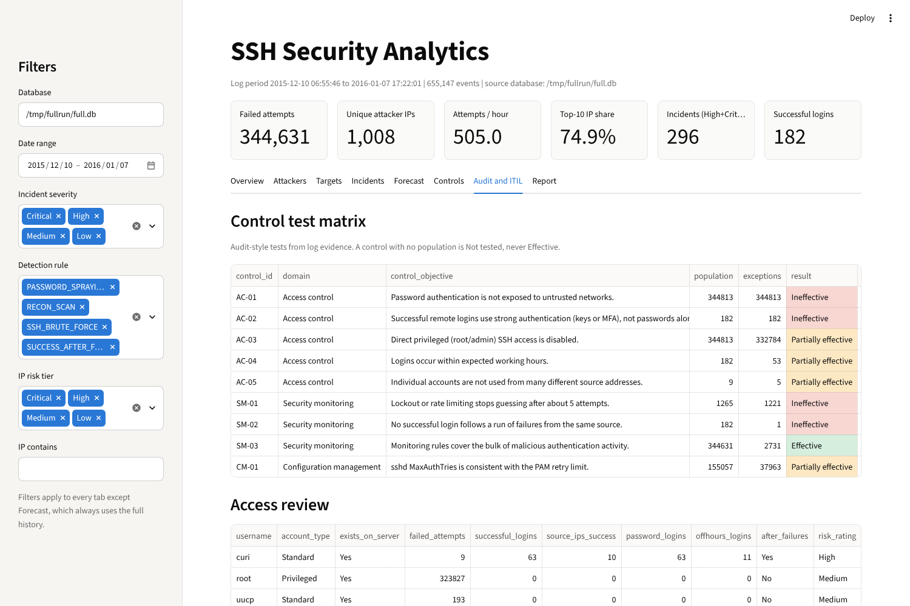
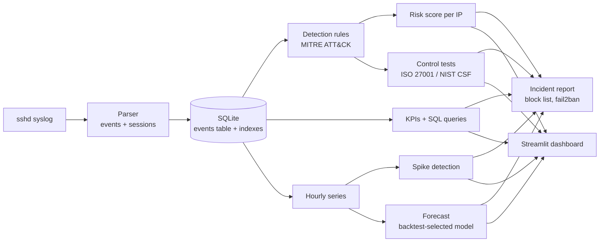

# Security Log Analytics: SSH Attack Detection, Risk Scoring and Forecasting

A SOC-style analytics system that turns raw SSH server logs into attack detections, a ranked list of attackers, an interactive dashboard, a plain-language incident report and a risk forecast. It runs on the public [Loghub](https://github.com/logpai/loghub) OpenSSH dataset (real logs from an internet-facing server) and follows the workflow a security analyst uses: **collect, parse, store, detect, score, visualise, forecast, report.**

I built it to show, on real security data, the skills a cyber risk analyst needs: security monitoring, SQL and Python data mining, predictive modelling, control assessment, and explaining technical findings in simple language.

**Live demo:** https://spriyangi232-lab.github.io/security-log-analytics/ (read-only: a saved excerpt of real results from the full 655,147-line Loghub log; uploads need the local install below)

## What it does

| Stage | What I built | Where |
|---|---|---|
| Parse | Regex parser for 16 sshd event types; rebuilds each SSH connection from its PID so lines without an IP are still attributed; expands `message repeated N times`; handles the missing year in syslog | `sla/parser.py` |
| Store and query | SQLite schema with indexes and 10 named SQL queries using window functions and a self-join | `sla/db.py`, `sql/queries.sql` |
| Detect | 5 explainable rules mapped to MITRE ATT&CK: brute force (T1110.001), password spraying (T1110.003), distributed attack on one account (T1110), success-after-failures / possible compromise (T1078), reconnaissance (T1595.001) | `sla/detection.py` |
| Score | 0-100 risk score per IP from six weighted components; the points each component contributes are stored, so every score can be explained | `sla/risk.py` |
| Spot spikes | Hour-of-day-adjusted robust z-score on hourly volume | `sla/anomaly.py` |
| Assess controls | 6 automated control tests (PASS/WARN/FAIL with evidence) mapped to ISO/IEC 27001:2022 Annex A and NIST CSF 2.0 | `sla/controls.py` |
| Forecast | Seasonal-naive, hour-of-day profile, ETS and SARIMA compete in a rolling-origin backtest; the winner forecasts the next 72 hours and 7 days with empirical 80% intervals | `sla/forecast.py` |
| Report | Executive summary, findings, prioritised incidents (ITIL P1-P4), recommendations, a block list and a fail2ban config, all generated from the results | `sla/reports.py` |
| Dashboard | Streamlit + Plotly: KPI cards, trend with spikes, hour-vs-date heatmap, attackers with score breakdown, targets, incidents, forecast, controls, report | `app/dashboard.py` |
| Audit and ITIL | 9-control test matrix (population, exceptions, result), per-account access review, ITIL incident / problem / change registers with SLA due times | `sla/grc.py` |
| Client deliverables | Excel control workpaper (live formulas), Word assessment report (condition / criteria / risk / recommendation), 6-slide PowerPoint summary, incident-response runbook | `sla/deliverables.py` |
| Quality | 30 automated tests and a GitHub Actions workflow | `tests/`, `.github/` |

## Results

These numbers are written automatically from the pipeline output (`python scripts/update_readme_results.py`), so they always match the data.

<!-- RESULTS:START -->
| Metric | Value |
|---|---|
| Log events analysed | 655,147 |
| Period | 2015-12-10 to 2016-01-07 |
| Failed login attempts | 344,631 |
| Unique attacker IPs | 1,008 |
| IPs behind 50% / 80% of attempts | 4 / 13 |
| Top-10 IP share of attempts | 74.9% |
| root + admin share of attempts | 96.3% |
| Attempts on non-existent usernames | 5.8% |
| Most targeted usernames | `root` (323,827), `admin` (8,073), `test` (543) |
| Share of attempts 22:00-05:59 (33% expected if uniform) | 36.1%  (1.08x) |
| Incidents detected (High+Critical) | 1,306 (296) |
| Forecast model (hourly / daily) | ets / mean_profile |
| Risk outlook | Low confidence |
<!-- RESULTS:END -->

Screenshots from the full Loghub run (655,147 events, 28 days):






**How to read the risk outlook.** The outlook compares the forecast for the next 24 hours with the recent norm, but only when the forecast passes its own checks: the best model must beat the naive baseline by a clear margin, the forecast must be consistent with the last 24 hours of actual volume, the hourly and daily models must roughly agree, and the prediction interval must not be very wide. If any check fails, the outlook reads **Low confidence** and reports observed volumes instead of a trend. On this dataset it reads Low confidence, because the log is one large campaign (peak day 77,389 failed attempts on 2016-01-04) followed by a quiet spell, which no model forecasts reliably. Thresholds are in `sla/config.py`.

## Audit and ITIL layer (client deliverables)

Besides detections, the pipeline produces what a cyber risk team hands to a client. Every run writes `deliverables/`:

| File | Purpose |
|---|---|
| `control_workpaper.xlsx` | 8 sheets: summary (live formulas), control matrix, access review, incident / problem / change registers, top attackers, notes. Yellow cells are for the reviewer. |
| `client_assessment_report.docx` | Findings written as condition, criteria, risk, recommendation, plus a management-response appendix |
| `executive_summary.pptx` | 6 slides for a steering meeting |
| `incident_response_runbook.md` | Triage, containment, recovery, escalation steps for SSH incidents |

Control tests follow audit practice: each reports a population, the exceptions found, and a result of Effective, Partially effective, Ineffective or Not tested. A control with no evidence is never marked Effective, and populations under 5 carry a small-sample caveat. SLA times, ISO/IEC 27001:2022 and NIST CSF 2.0 references are illustrative and should be replaced by the client's own policy.

## Architecture



## Quick start

```bash
pip install -r requirements.txt
python -m pytest -q                      # 22 tests

# 1. Real data: download the full OpenSSH log from the Loghub repository (see "Data"),
#    save it as data/raw/OpenSSH_full.log, then:
python -m sla run --log data/raw/OpenSSH_full.log --year 2015
python scripts/update_readme_results.py  # fills the Results table above

# 2. Dashboard
streamlit run app/dashboard.py

# Quick look without the full download: bundled 2,000-line real sample
python -m sla run --log data/raw/OpenSSH_2k.log --out reports/sample_run_loghub_2k
```

Outputs are written to `reports/`: `incident_report.md`, `incidents.csv`, `ip_risk.csv`, `control_tests.csv`, `kpis.json`, forecasts and their backtests, `blocklist.txt`, `fail2ban_jail.local`. Ready-made examples are in `reports/sample_run_loghub_full/` (full dataset, including the Excel, Word and PowerPoint deliverables) and `reports/sample_run_loghub_2k/` (2,000-line sample).

Processing speed: about 25 seconds for the full 655,000-line log (parse, load, detect, forecast, report, deliverables).

## Data

* **Real data:** the Loghub OpenSSH dataset, about 655,000 lines of sshd logs from a lab server exposed to the internet. A 2,000-line sample is bundled in `data/raw/OpenSSH_2k.log` and covers about four hours, which is enough to demonstrate parsing, detection and reporting but not forecasting.
* **Getting the full log:** download `SSH.tar.gz` from the Loghub Zenodo record (linked in the OpenSSH row of the [Loghub table](https://github.com/logpai/loghub)), extract it, and save the `.log` file as `data/raw/OpenSSH_full.log`. It is 655,146 lines and 28.4 days, about 70 MB, so it is not committed (see `.gitignore`). Please cite the Loghub paper if you use it.
* **Year assumption:** syslog lines have no year. `--year` supplies it (default 2015) and the parser rolls it forward on a December to January wrap. It only affects labels and weekday, not any count.
* **Synthetic demo data:** `python -m sla demo` generates a 30-day log in the same format using only RFC 5737 documentation IP ranges, so no real host is involved. It exists to exercise forecasting and the dashboard at scale and in the tests. Its numbers are never presented as findings.

## Design decisions

* **No double counting.** One failed login writes four or five log lines (invalid user, PAM failure, pre-auth notice, `Failed password`). Only `Failed password` lines count as attempts, so KPIs are not inflated four-fold.
* **Episodes, not single events.** Attempts from one IP are grouped into episodes separated by 30 quiet minutes, then measured with a sliding 5-minute window. This separates a burst of automated guessing from a stray typo.
* **Spraying vs brute force.** Many usernames with few tries each is spraying; few usernames with many tries is brute force. The distinction matters because the fix differs.
* **Honest forecasting.** Every candidate model is scored against a seasonal-naive baseline on a rolling backtest. If nothing beats the baseline, the baseline is used. Prediction intervals come from the model's real backtest errors, not an assumed distribution. With less than 7 days of logs the system refuses to forecast rather than produce a misleading chart. Forecasts use whole hours only (a partial first or last hour would look like a collapse in volume), and the risk outlook reports Low confidence when the forecast fails its sanity checks.
* **Robust statistics.** Attack volume is heavy-tailed, so spike detection uses medians and MAD on a log scale instead of mean and standard deviation.
* **Explainable scoring.** Risk weights live in `sla/config.py`; each IP's score is split into component points that the dashboard shows. A confirmed success after repeated failures always escalates to Critical.
* **A control view, not just alerts.** Findings are also written as control tests (for example, "lockout stops guessing after about 5 attempts": FAIL when an episode reached 286 attempts), because clients are assessed on whether controls work.

## Limitations

* Rules are heuristics tuned for SSH on a single host; thresholds should be re-tuned per environment (`sla/config.py`).
* An IP address is not a person. NAT, proxies and botnets mean a block list must be reviewed before enforcement.
* Forecasts describe likely volume from past behaviour; they cannot anticipate a brand-new campaign.
* There is no GeoIP enrichment or threat-intelligence feed yet.

## Roadmap

* Wazuh lab on virtual machines I own, attacking my own test machine and analysing those logs too (never any system I do not own).
* GeoIP and reputation enrichment; Prophet as an extra forecasting candidate; containerised deployment.

## Project layout

```
sla/          parser, db, detection, risk, anomaly, controls, grc, deliverables, forecast, reports, pipeline, synthetic
sql/          named SQL queries (window functions, self-join)
app/          Streamlit dashboard
tests/        pytest suite (parser, rules, forecasting, GRC, pipeline, dashboard)
docs/         KPI definitions, screenshots
reports/      generated outputs; sample_run_loghub_full/ and sample_run_loghub_2k/ are committed examples
```

## Author

Priyangi Singh Chouhan, B.Tech Computer Science Engineering, Acropolis Institute of Technology & Research, Indore.

## Web app (Gate 2: Overview screen)

React + TypeScript + IBM Carbon (Gray 10, teal interaction colour) + Apache ECharts, over a read-only FastAPI layer.

```bash
python -m sla run --log SSH.log --year 2015 --db data/datasets/openssh.db --out reports/openssh
SLA_DATA_DIR=data/datasets uvicorn api.main:app --port 8000        # API, OpenAPI at /docs
cd web && npm install && npm run dev                                # http://localhost:5173
npm run types        # regenerate TS types from api/openapi.json after changing the API
```

Every number and sentence on screen comes from `sla/overview.py`; the UI computes nothing. All rules and formulas live in `sla/rules.py`.
